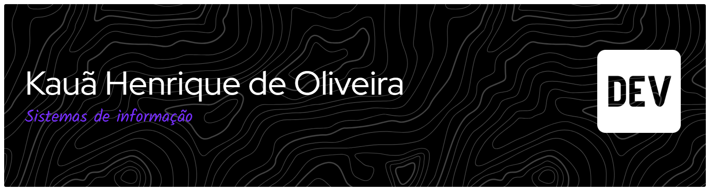

# Olá, eu sou o Kauã Henrique 👋

**Estudante de Sistemas de Informação na PUC Minas 💻**
Desenvolvedor em formação | Belo Horizonte, MG 📍

---

## 👨‍💻 Sobre mim

- 🎓 Cursando **Sistemas de Informação** na [PUC Minas](https://www.pucminas.br)
- 💼 Trabalho na **Prefeitura de Belo Horizonte**
- 📚 Estudando **Programação Orientada a Objetos** com C#
- 🌱 Aprendendo e construindo projetos para evoluir na carreira de desenvolvedor

---

## 🛠️ Tecnologias

---

## 🚀 Projetos em destaque

| Projeto | Descrição | Tecnologias |
|---------|-----------|-------------|
| [Ecofossil](https://github.com/Kauaholiveira/Ecofossil) | | JavaScript |
| [MetaCerta](https://github.com/Kauaholiveira/MetaCerta) | MetaCerta é uma plataforma de planejamento financeiro pessoal que permite cadastrar metas mensais ao longo do ano, acompanhar o progresso das economias e desbloquear recompensas ao atingir os objetivos. Organize suas finanças, acompanhe suas conquistas e transforme suas metas em experiências, como passeios, viagens, restaurantes e muito mais.| HTMl,CSS,JAVASCRIPT |

---

## 📊 GitHub Stats

---

